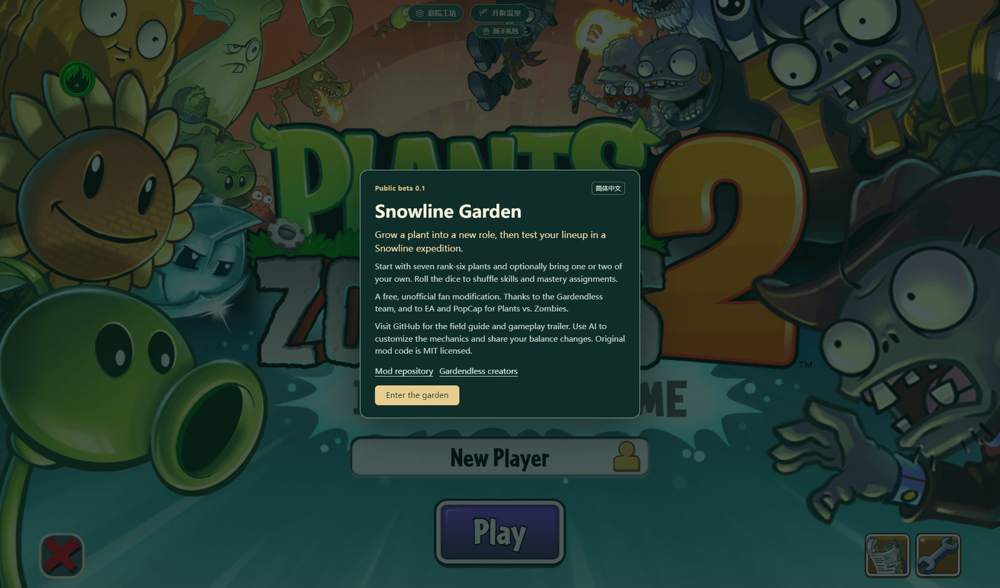
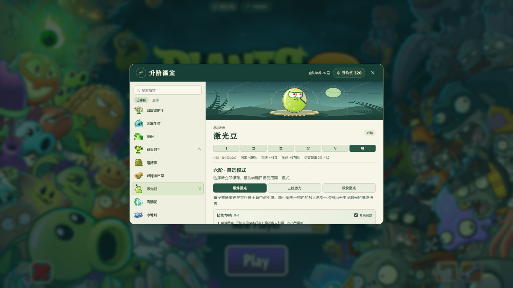
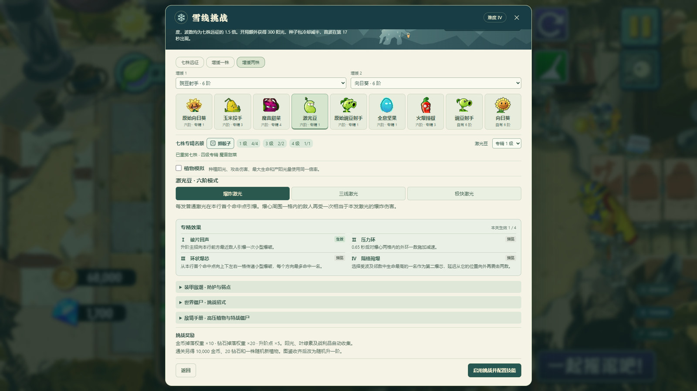
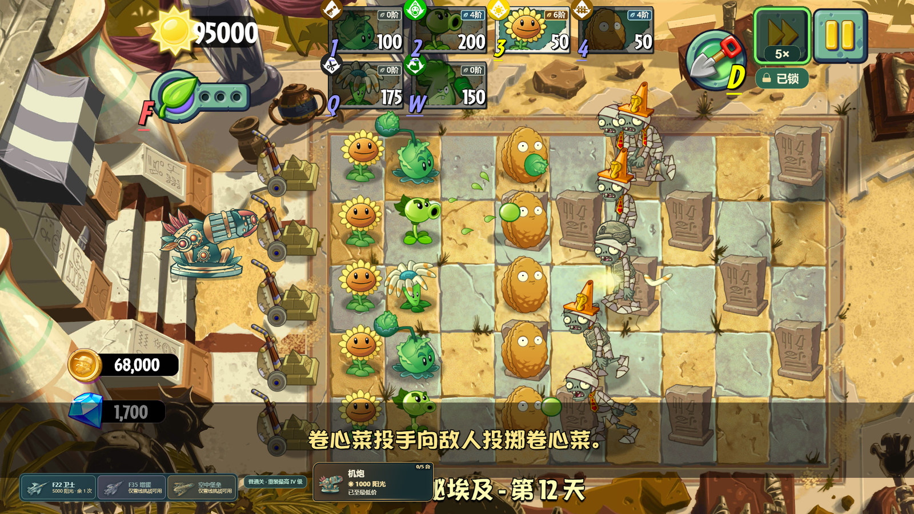

# Snowline Garden · Public beta 0.1

[简体中文](README.md) · [Windows patch](https://github.com/songsiyi2006-chem/pvz2-gardendless-snowline/releases/download/v0.1/Snowline-Patch-v0.1-Windows.zip) · [Bilingual illustrated field guide](https://github.com/songsiyi2006-chem/pvz2-gardendless-snowline/releases/download/v0.1/Snowline-Field-Guide-v0.1.pdf) · [Two-minute gameplay trailer, no audio](https://github.com/songsiyi2006-chem/pvz2-gardendless-snowline/releases/download/v0.1/Snowline-v0.1-Trailer.mp4)

**Plant progression and Snowline expeditions** are the heart of this free, unofficial Gardendless mod. Grow a plant into a different battlefield role, then take that build into familiar levels against armor, mortar crews and camouflaged attackers. The title card and public documentation are bilingual. The gameplay captures show the Chinese mod interface.

Select the image to download the two-minute gameplay trailer. All images and footage come from the released build. A separate demonstration profile provides the advanced plants and equipment shown here.

## Start a fresh garden

1. Obtain the original Gardendless 0.16.24 standalone Windows EXE. The supported file is 1,211,438,592 bytes with SHA-256 `02f0bf4dcf17bc6afa09ce8e752ebd162dc6b06555dc981f56693fdb5e172624`. [Upstream project and download links](https://github.com/Gzh0821/pvzg_site)
2. Extract the entire Windows patch ZIP, keeping the adjacent `mod` directory. Run `Snowline-Patch.exe`, select your original executable and choose a new destination. The patch checks the base and builds a separate playable executable on your computer.
3. Start the new executable. The beta uses its own local save. Ancient Egypt's regular map progression and nine local plants are open at the start. Earn progress in the other worlds through play. Finishing the tutorial makes a one-time gift available with one world key, 1,000 diamonds, 100 rank points, 200,000 coins and one plant-choice card. No tester profile is distributed.

## Grow a plant into a role

Ordinary wins at difficulties I–IV award 3, 5, 8 and 12 rank points. Each of six rank increases adds 5% of base damage, 5% of base attack speed and 100% of base health. Potato Mine converts speed into shorter arming time. Sunflower converts damage into more sun per drop. Each permanent training step also gives the whole garden another 0.5% attack speed and 3% health. The seed tray displays effective rank. Imitater inherits the plant it copies.

At rank six, choose one of three skill modes. Each mode has four mastery levels purchased separately with rank points, coins and diamonds. Laser Bean can produce an explosion, cover three lanes or increase its firing rate by 500%. The seed-selection screen shows what each mastery actually does. The garden-wide talent tree improves seed recharge, survival, action speed and critical hits.

## Three ways to enter an expedition

Select the highest difficulty on an eligible regular stage with free seed selection. Snowline supplies seven rank-six plants. Assign four mastery-I slots, two mastery-III slots and one mastery-IV slot. Pick skills by hand or roll the dice for a legal allocation. Ordinary fixed-loadout and conveyor stages use their own rank-five rule.

| Relative to ordinary enemies on the same stage | Seven supplied plants | Seven plus one or two owned plants |
|---|---:|---:|
| Movement speed | 1.6× | 1.92× |
| Attack damage | 3× | 6× |
| Body health before additional armor health | 5× | 7.5× |
| Wave count | Rebuilt from the original stage | About 1.5× the seven-plant expedition |

You have **17 game seconds** to develop. Expeditions start with 300 extra sun and halve seed recharge. Flags are closer together. Plant zombies join from the first flag and Prism Grass arrives from the second. Reinforcements keep their owned rank and mastery. One or two reinforcements use the same enemy difficulty. Plant simulation can be set per plant from 1× to 5×. It multiplies planting cost, damage, body health and sun production by the selected factor.

An expedition victory counts as normal stage progression, including the first clear. Coin, diamond and rank-point reward weights are 10×, 20× and 5×. Main pickups are collected automatically. Clearing also awards 10,000 coins, 20 diamonds and a random unowned plant. Once the collection is complete, a random plant gains a rank. A fully ranked collection gains one more garden-wide training step.

## Read the formation before choosing a weapon

At ordinary difficulties I–IV, **6%, 12%, 20% and 30%** of enemies receive a helmet and vest together. The special reinforcement budget is one to four plant zombies and the same number of mortar crews, according to difficulty. A scripted stage can finish before all its reserves arrive. Difficulty IV includes a small number of high-threat plant zombies. Mortars favor your main damage dealers. Their targeting markers give you time to interrupt, move a plant or intercept the shell.

Snowline shield guards stop lasers coming from the front and screen enemies behind them from frontal explosions. Elite guards cover nearby positions in adjacent lanes as well. Their shields have 24,000 and 48,000 durability respectively. Armor-piercing autocannons erode shields. Remote artillery reaches the back line directly, where personal helmets and vests still resist explosions.

One randomly placed enemy in every group of ten live expedition spawns receives camouflage, regardless of species. Its personal helmet and vest are weaker. Plants can target it. Ground heavy weapons and aircraft cannot pick it as a direct target, and collateral blasts from these weapons lose 80% of their damage before armor. Keep plants covering the approach.

## Switch equipment in seed selection

Pick one ground heavy weapon. Aviation and interceptors have separate slots. In ordinary adventure, ground heavy equipment and aviation operate at up to level IV. Only one F22 may be deployed. Expeditions use purchased levels up to VII. Conveyors, Last Stand and other stages without plant-based sun default to a free permanent sniper and disable aircraft for that battle.

An autocannon begins at 1,000 sun. Each deployment adds 250 to the quote. Every 25 game seconds the quote falls by 50, to a floor of 1,000. Five can be active. The level-V armor-piercing mode focuses on targets in the same lane. Remote artillery costs a flat 3,000. The F22 scouts and provides sustained fire. The F35 delivers 40 seconds of support, including persistent incendiary zones. Two Air Fortresses can be called per expedition for 20,000 and 40,000 sun.

Battle speeds are 1×, 1.5×, 2×, 3×, 4× and 5×. The speed lock preserves your selection during a breach warning. Holographic skill effects can be turned off during play while the underlying skills continue to work.

## Noncommercial release and acknowledgments

This independent public beta is free for play, testing and learning. Downloads and unlocks are free of charge. The project carries no ads. Thank you to **Gzh0821, the Gardendless developers, translators and community**, whose PC adaptation made these experiments possible. Thank you to **PopCap and Electronic Arts** for Plants vs. Zombies and its characters. [Gardendless on GitHub](https://github.com/Gzh0821/pvzg_site) · [Credits and third-party rights](THIRD-PARTY.md)

You are welcome to use AI tools to customize our original mechanics. Try changing one plant or one weapon, replay the same level and lineup, then share the difficulty and measured results in an issue or pull request. The original mod code is MIT licensed. Upstream software and third-party artwork retain their respective rights. [Customization guide](CUSTOMIZING.md) · [MIT license](LICENSE)
