# Snowline Garden · Public beta 0.2

[简体中文](README.md) · [Windows patch](https://github.com/songsiyi2006-chem/pvz2-gardendless-snowline/releases/download/v0.2/Snowline-Patch-v0.2-Windows.zip) · [35-page Tyrant and Nightmare guide, Chinese PDF](https://github.com/songsiyi2006-chem/pvz2-gardendless-snowline/releases/download/v0.2/Snowline-Nightmare-Guide-v0.2.pdf) · [Two-minute silent trailer, 1080p MP4](https://github.com/songsiyi2006-chem/pvz2-gardendless-snowline/releases/download/v0.2/Snowline-v0.2-Trailer.mp4) · [Download earlier releases](docs/HISTORY.en.md)

Snowline Garden is a free, unofficial gameplay mod for PVZ2 Gardendless. Rank points earned in ordinary adventure can turn one plant into three different specialists. Take that garden to an expedition on the highest difficulty, use a planting boost to save a lane, or send a precision strike after the mortar crew behind the shield wall.

[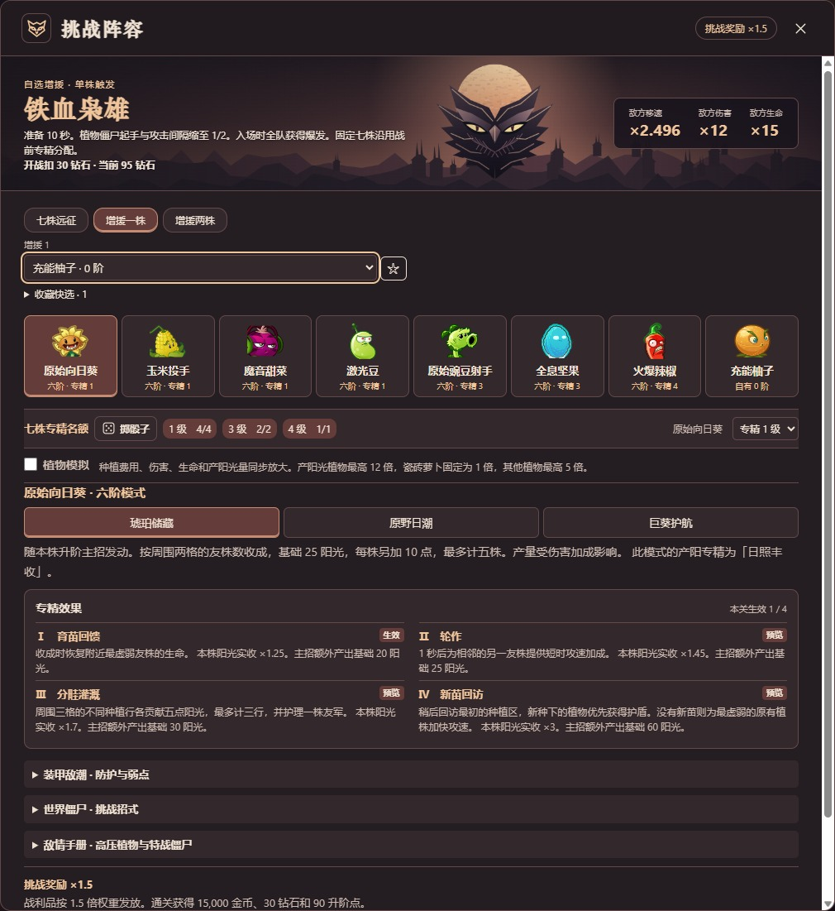](https://github.com/songsiyi2006-chem/pvz2-gardendless-snowline/releases/download/v0.2/Snowline-v0.2-Trailer.mp4)

**Coming from the public 0.1 Revision 2?** This release also brings together Compatibility mode, siege titans, three super-plant families, Iron Tyrant and Nightmare expeditions, revised armor and new air support. Images labeled 0.2 and the linked trailer show this release. Combat captures use a separate demonstration formation. Earlier 0.1 captures illustrate the established controls. The changelog covers each revision. [Full changes](docs/CHANGELOG-0.2.en.md)

## Install and continue your garden

1. Use your own standalone Gardendless Windows executable. Supported releases are **0.16.24 Standard, 0.16.24 Lite and 0.16.14 Standard**. Lite uses AVIF textures and requires a WebView2 runtime with AVIF decoding. [Official upstream releases](https://github.com/Gzh0821/pvzg_site/releases)
2. Extract the whole archive. Run `Snowline-Patch.exe`, select your original EXE, and give the new game a fresh filename. The patch checks the scripts and resource layout on your computer. For another Windows build, run `.\Snowline-Patch.exe --check "D:\Games\pvzge.exe"` first. This validates the integration points. Gameplay on other builds needs its own playtest.
3. **Launch the generated game to continue.** Within the same Windows account and game data directory, an existing Snowline 0.1 or 0.2 save opens automatically. A single recognizable legacy source is copied automatically, including all player slots. With saves from both the original and the earlier Snowline edition, the earlier Snowline save is preselected. You can select the original instead. Stage progress, plants, currency and the active slot carry over, as do earlier Snowline ranks, talents and equipment. Both source saves stay available in their original games.
4. In the source picker, both Enter and Escape continue with the selected save. Starting fresh requires two explicit choices. The second screen focuses the button that returns to your saves. Without a previous save the game creates its starting garden. To move between computers or game data directories, export and import your save using the original game's player screen.

The 0.2 nine-card Nightmare entry was exercised on a separate 0.16.24 Standard profile. With 29 diamonds the seed chooser stayed open. With 95, two consecutive start presses left 65. Planting Citron triggered the native boost and preserved both previously bought charges.

All three base releases were tested through battle and saved progress on Windows for Revision 2. Version 0.2 uses the same save format. If a scripted objective conflicts with the mod, open **Mod & Compatibility** in Settings, confirm the switch and retry. The game returns to the main menu and keeps your saved progress. You can turn the mod back on after clearing the stage.

0.16.15 Standard is on hold. During testing, 360 quarantined the generated executable before launch. The cause remains unconfirmed. The patch currently declines this base version.

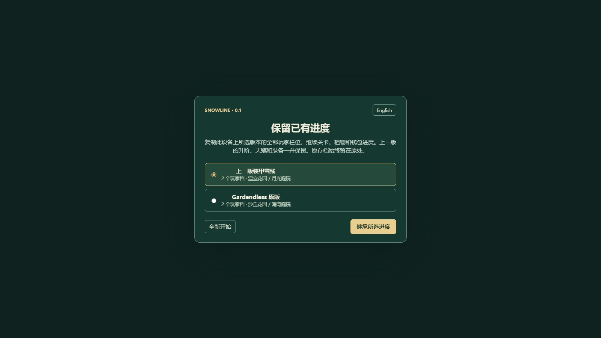

New profiles start with Ancient Egypt's regular stages and nine regional plants unlocked. Earn progress in other worlds through play. Finishing the tutorial unlocks a one-time gift of one world key, 1,000 diamonds, 100 rank points, 200,000 coins and one plant-choice card. The public patch contains no player profile.

## Grow a plant into a role

Ordinary wins at difficulties I–IV award 3, 5, 8 and 12 rank points. Each of six rank increases adds 5% of base damage, 5% of base attack speed and 100% of base health. Potato Mine converts speed into shorter arming time. Sunflower converts damage into more sun per drop. Each permanent training step adds 0.3% of base action speed and 10% of base health across the garden, plus 0.01 to the critical damage multiplier. Existing training counts in adventure and expeditions. Temporary ranks do not add permanent training steps. The seed tray displays effective rank. Imitater inherits the plant it copies.

**Additional playable plants registered by a compatible game** use numerical progression. Each rank adds 10% of base damage, 10% of base attack speed and 200% of base health. Six ranks give **1.60× damage, 1.60× speed and 13× health** before garden-wide bonuses. Standard sun producers scale yield and production speed. These plants keep their native behavior at rank six. The three selectable skills and mastery paths below apply to plants with dedicated Snowline designs.

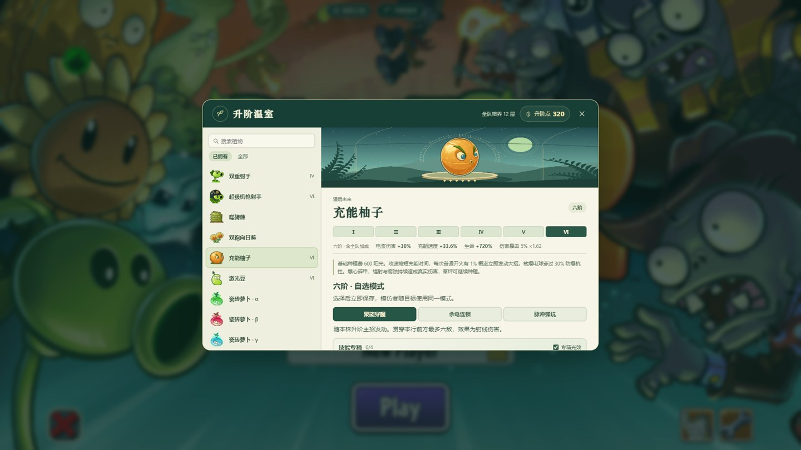

At rank six, choose one of three skill modes. Each mode has four mastery levels purchased separately with rank points, coins and diamonds. Laser Bean can produce an explosion, cover three lanes or increase its firing rate by 500%. The seed-selection screen shows what each mastery actually does. The garden-wide talent tree improves seed recharge, survival, action speed and critical hits.

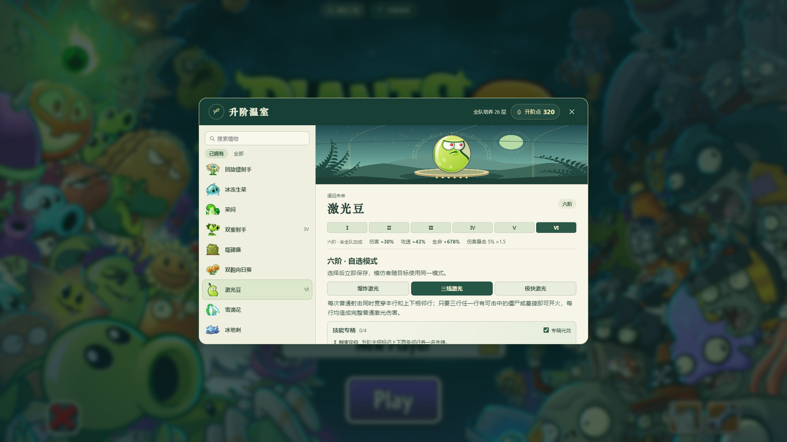
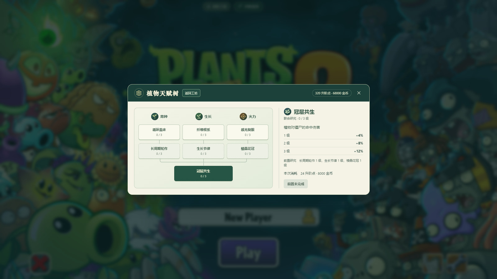

At rank six with mastery IV selected, dedicated sun producers gain a separate 3× sun-yield multiplier. With equal garden training and simulation disabled, a Sunflower drop is about 3.12× its rank-five value. These skill paths can also shield nearby plants and intercept shells.

## Which plant changes the expedition?

Enter a free-selection stage on its highest difficulty and open Snowline expeditions. You receive seven rank-six plants and can fill up to two extra slots with plants you own. Mega Gatling Pea, Tile Turnip and Citron form three super-plant families. **Only your extra slots count.** Two Tile Turnip variants count once. Save favorites for quick selection. Super plants stay at the top.

| Fielded lineup | Setup | Enemy speed | Enemy damage | Enemy body health | Entry | Clear reward in coins / diamonds / rank points |
|---|---:|---:|---:|---:|---:|---|
| Seven supplied plants | 13 s | 1.6× | 3× | 5× | Free | 10,000 / 20 / 60 |
| One or two ordinary reinforcements | 13 s | 1.92× | 6× | 7.5× | Free | 10,000 / 20 / 60 |
| One super family · Iron Tyrant | 10 s | 2.496× | 12× | 15× | 30 diamonds | 15,000 / 30 / 90 |
| Two super families · Nightmare | 7 s | 3.2448× | 24× | 30× | 30 diamonds | 20,000 / 40 / 120 |

Multipliers use ordinary enemies on the same stage as the baseline. Armor adds health separately. Bringing any reinforcements raises wave count to about 1.5× the seven-plant expedition. Every expedition adds 1,000 starting sun and halves seed recharge. Plant zombies join from the first flag. Prism Grass joins from the second flag and can drive your sun balance below zero.

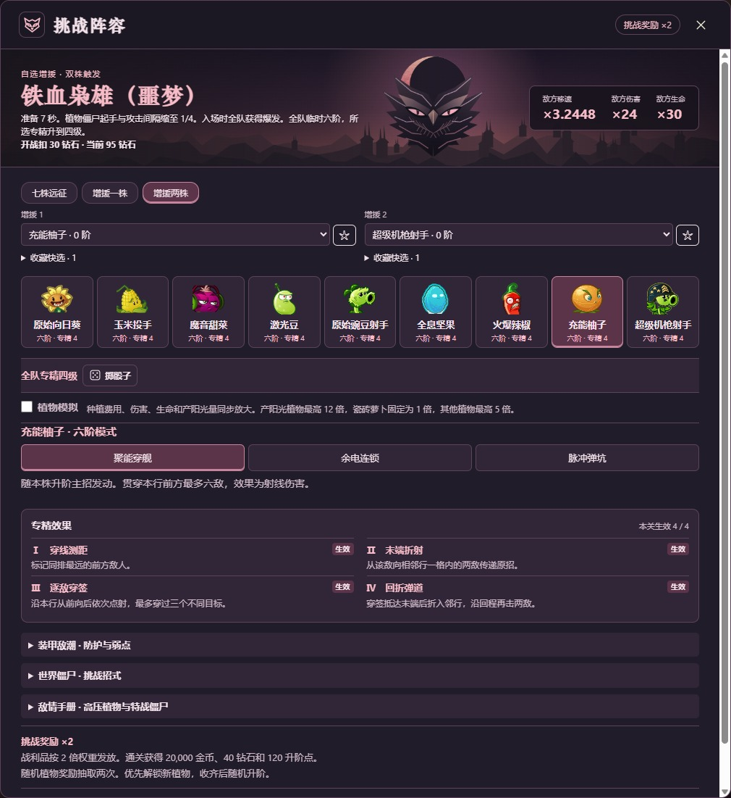

- **Entry and retries.** You can edit or cancel a lineup for free. A formal Tyrant or Nightmare attempt charges once when you press the native start button. Starting a retry costs another 30 diamonds. Both modes give the seed tray its native planting boosts and preserve boosts already bought for your account.
- **Skills and mastery.** In ordinary expeditions and Iron Tyrant, the seven supplied plants share four mastery-I slots, two mastery-III slots and one mastery-IV slot. Reinforcements keep their owned training. Nightmare temporarily sets all dedicated plants to rank six and the selected skill to mastery IV. Imitater copies the plant immediately to its left. Extra compatible plants retain numerical progression. Ordinary fixed-deck and conveyor stages use rank five.
- **Plant simulation.** Set ordinary plants up to 5×, sun producers up to 12× and Tile Turnip at 1×. Simulation multiplies planting cost, damage, maximum health and applicable sun yield. Imitater uses its copied plant's multiplier.
- **Loot and progress.** A win advances the original stage, including a first clear. Main drops are collected automatically. The underlying expedition weights for coins, diamonds and rank points are 10×, 20× and 5×. The table lists the fixed clear payout. Iron Tyrant also awards one plant roll and a 50% chance at a second. Nightmare awards two. A complete collection receives random ranks, then garden-wide training once all ranks are full.

## Read the formation before choosing a weapon

At ordinary difficulties I–IV, **6%, 12%, 20% and 30%** of enemies receive a helmet and vest together. The special reinforcement budget is one to four plant zombies and the same number of mortar crews, according to difficulty. A scripted stage can finish before all its reserves arrive. Difficulty IV includes a small number of high-threat plant zombies. Mortars favor your main damage dealers. Their targeting markers give you time to interrupt, move a plant or intercept the shell.

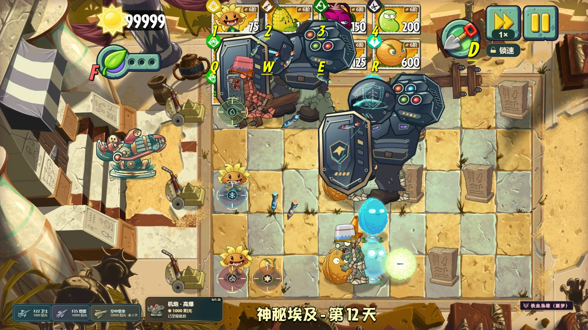

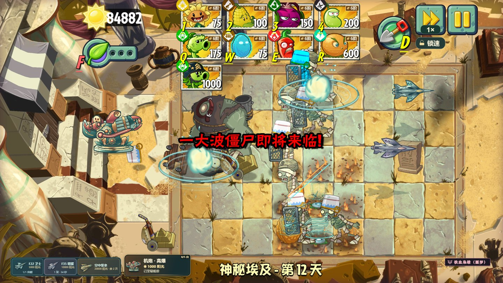

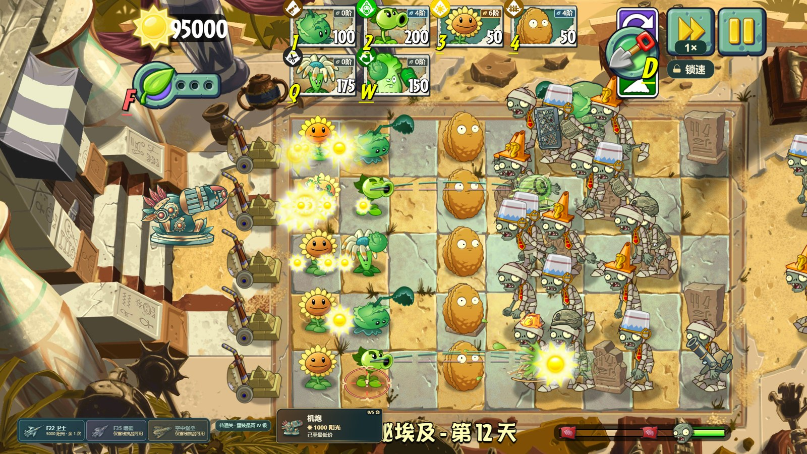

Snowline shield guards stop lasers coming from the front and screen enemies behind them from frontal explosions. Elite guards cover nearby positions in adjacent lanes as well. Their shields have 24,000 and 48,000 durability respectively. Armor-piercing autocannons erode shields. Remote artillery reaches the back line directly, where personal helmets and vests still resist explosions.

One randomly placed enemy in every group of ten live expedition spawns receives camouflage, regardless of species. Its personal helmet and vest are weaker. Plants can target it. Ground heavy weapons and aircraft cannot pick it as a direct target, and collateral blasts from these weapons lose 80% of their damage before armor. Keep plants covering the approach.

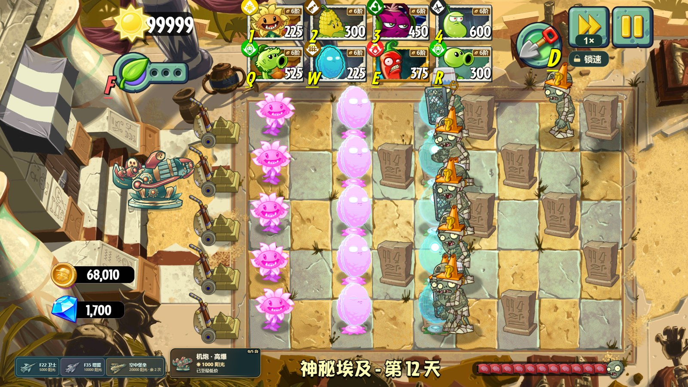

Every expedition brings at least six siege titans. Their rear racks fire high-explosive, freezing, toxin and incendiary rockets that installed interceptors can stop. Intact titan armor absorbs about 99% of explosive and piercing damage, and Citron cannot instantly remove a titan. Nightmare helmets gain 1.75× durability and vests gain 2×, with additional resistance to direct hits, blasts and armor stripping. Check which enemy is shielding the back line before calling in a strike.

## Switch equipment in seed selection

Pick one ground heavy weapon. Aviation and interceptors have separate slots. In ordinary adventure, ground heavy equipment and aviation operate at up to level IV. Only one F22 may be deployed. Expeditions use purchased levels up to VII. Conveyors, Last Stand and other stages without plant-based sun default to a free permanent sniper and disable aircraft for that battle.

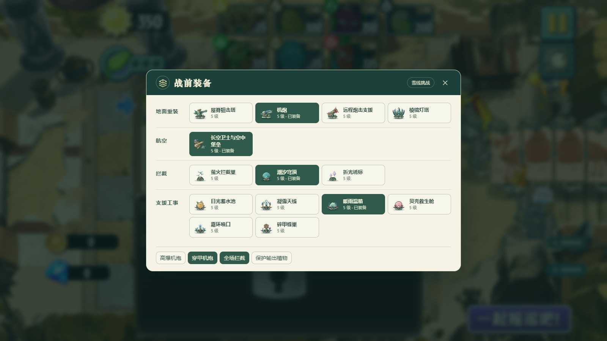
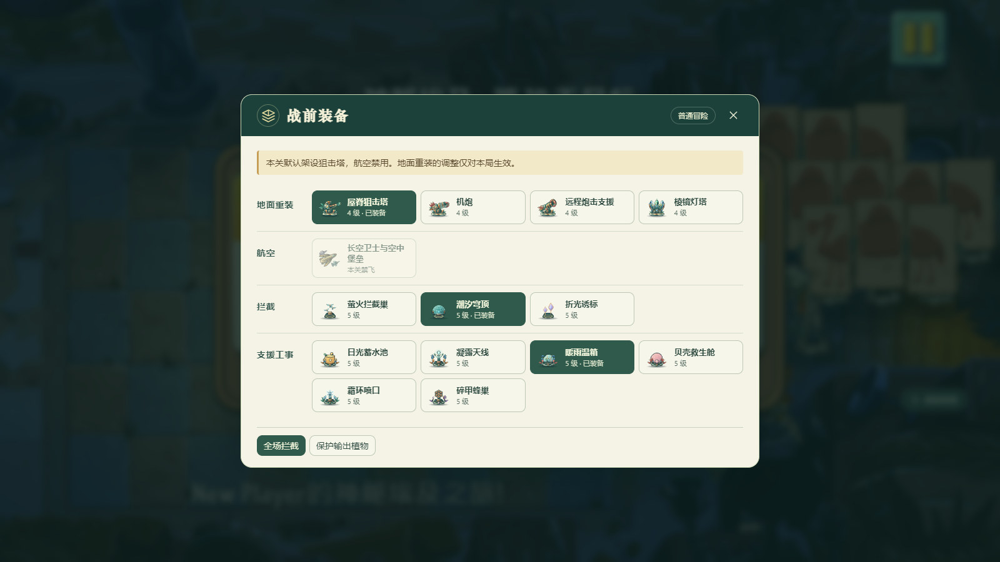

An autocannon begins at 1,000 sun. Each deployment adds 250 to the quote. Every 25 game seconds the quote falls by 50, to a floor of 1,000. Five can be active. The level-V armor-piercing mode focuses on targets in the same lane. Remote artillery costs a flat 3,000. The F22 scouts and provides sustained fire. The F35 delivers 40 seconds of support, including persistent incendiary zones. Two Air Fortresses can be called per expedition for 20,000 and 40,000 sun.

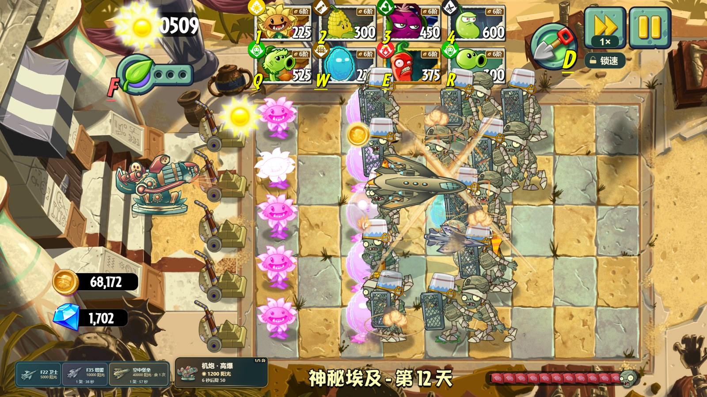

Each powered F22 adds 2% plant damage, 0.05 to the critical damage multiplier and 0.5 percentage points of armor shred for every plant. Shred caps at 5% normally and 12% in Nightmare. In Nightmare the F35 can send its secondary guided bomb into another lane. The Fortress cycles through guided, bunker-buster and airburst payloads. Its airbursts bypass the protection shield guards and titans extend to units behind them.

Battle speeds are 1×, 1.5×, 2×, 3×, 4× and 5×. The speed lock preserves your selection during a breach warning. Holographic skill effects can be turned off during play while the underlying skills continue to work.

## Noncommercial release and acknowledgments

This independent public beta is free for play, testing and learning. Downloads and unlocks are free of charge. The project carries no ads. Thank you to **Gzh0821, the Gardendless developers, translators and community**, whose PC adaptation made these experiments possible. Thank you to **PopCap and Electronic Arts** for Plants vs. Zombies and its characters. [Gardendless on GitHub](https://github.com/Gzh0821/pvzg_site) · [Credits and third-party rights](THIRD-PARTY.md)

You are welcome to use AI tools to customize our original mechanics. Try changing one plant or one weapon, replay the same level and lineup, then share the difficulty and measured results in an issue or pull request. The original mod code is MIT licensed. Upstream software and third-party artwork retain their respective rights. [Customization guide](CUSTOMIZING.md) · [MIT license](LICENSE)
