# 装甲雪线与庭院工坊 · 公开测试版 0.2

[English](README.en.md) · [下载 Windows 补丁](https://github.com/songsiyi2006-chem/pvz2-gardendless-snowline/releases/download/v0.2/Snowline-Patch-v0.2-Windows.zip) · [枭雄与噩梦手册 · 35 页中文 PDF](https://github.com/songsiyi2006-chem/pvz2-gardendless-snowline/releases/download/v0.2/Snowline-Nightmare-Guide-v0.2.pdf) · [两分钟实机宣传片 · 1080p 无音轨](https://github.com/songsiyi2006-chem/pvz2-gardendless-snowline/releases/download/v0.2/Snowline-v0.2-Trailer.mp4) · [查看历史版本](docs/HISTORY.md)

这是一款免费的 PVZ2 Gardendless 非官方玩法改版。普通关积累的进阶点，能把一株植物培养成三种不同角色。在最高难度的雪线挑战里，你可以带自己的植物增援，借一次落地爆发抢回节奏，也可能因为一面仍然完好的盾，错过打断后排炮手的机会。

[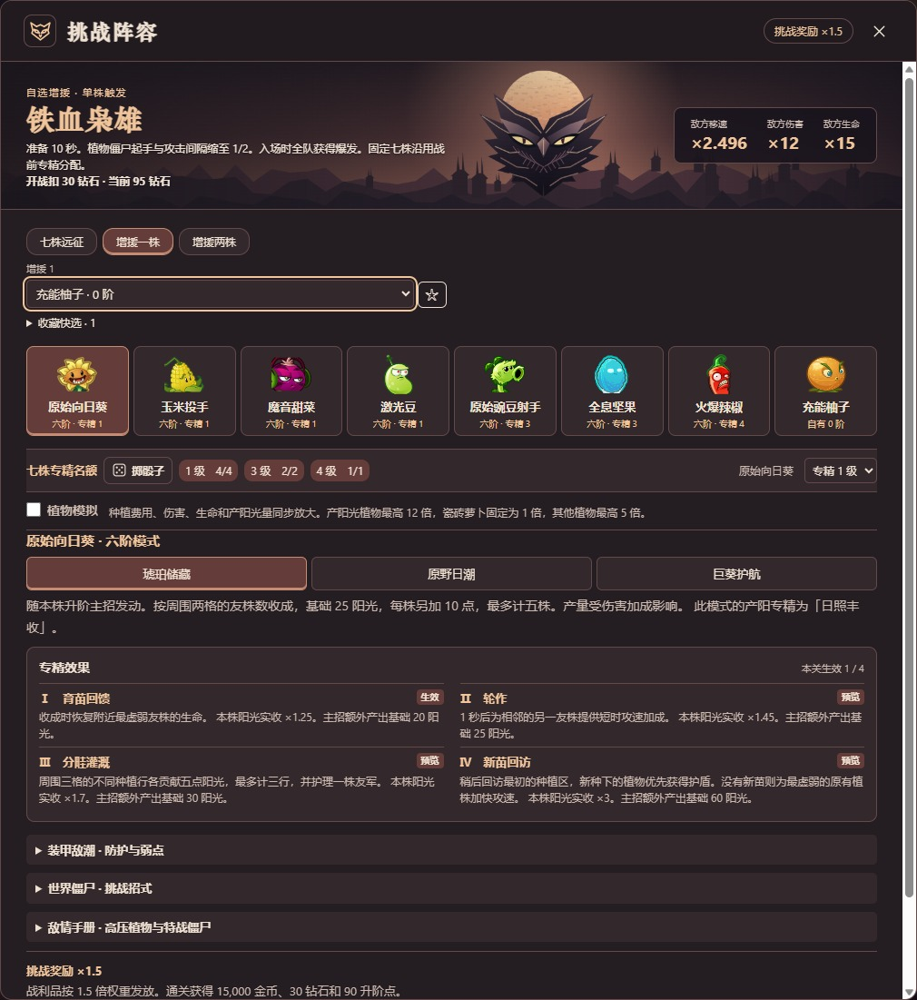](https://github.com/songsiyi2006-chem/pvz2-gardendless-snowline/releases/download/v0.2/Snowline-v0.2-Trailer.mp4)

**从已公开的 0.1 R2 升级**，本次会一并获得兼容模式、超级重装巨人、三种超级植物、枭雄与噩梦战场、新装甲和航空改造。标注 0.2 的图片与本次宣传片均取自新版。战斗截图使用独立演示阵地。其余操作示意沿用 0.1 实机。详细差异按功能和修订列在更新记录中。[逐项更新](docs/CHANGELOG-0.2.md)

## 安装补丁，继续原来的花园

1. 准备自己下载的 Gardendless Windows 单文件游戏。目前已适配 **0.16.24 标准版、0.16.24 Lite、0.16.14 标准版**。Lite 使用 AVIF 贴图，需要能解码 AVIF 的 WebView2 运行时。[原项目历史版本](https://github.com/Gzh0821/pvzg_site/releases)
2. 完整解压补丁，双击 `Snowline-Patch.exe`，选择原版 EXE，再为生成的游戏选择新文件名。补丁会在本机检查游戏脚本和资源布局，原版可继续运行。对其他 Windows 构建，可运行 `.\Snowline-Patch.exe --check "D:\Games\pvzge.exe"` 先做兼容性预检。预检核对挂载点，实际游玩仍需该版本的实机验证。
3. **直接运行生成的游戏即可续玩。** 在同一个 Windows 用户、同一游戏数据目录内，已有雪线 0.1 或 0.2 存档会直接打开。只有一个可识别旧档来源时，自动复制其中的全部玩家栏位。原版与上一版雪线都有存档时，默认选中上一版雪线，也可以主动选择原版。关卡、植物、钱包和当前玩家栏位随档继承，雪线档还保留升阶、天赋与装备。旧版存档保留在原处。
4. 双来源选择界面的 Enter 和 Esc 都会继续继承。手动点“全新开始”还需再次确认，返回按钮默认获得焦点。没有旧档的玩家会获得本版起始花园。跨电脑或不同游戏数据目录，可通过原游戏的玩家界面导出和导入存档。

0.2 在 0.16.24 标准版的独立测试档实测了九卡噩梦开战。余额 29 钻时留在选卡，余额 95 钻时连续按两次开战后剩 65 钻。落地充能柚子触发了原版爆发，原有两次购买库存均保留。

这三个基础版本在 0.1 R2 的 Windows 实测中都完成过进关、实战和续档。0.2 沿用同一存档格式。若某个剧情脚本与改版冲突，在设置里打开“改版与兼容设置”，切到兼容模式后重试。本次切换会重新载入游戏并结束当前尝试，可以沿用已保存进度，过关后再从设置恢复改版。

0.16.15 标准版暂缓支持。测试机上的 360 在启动前隔离了该版本生成的 EXE，目前无法确认是否误报。补丁会识别该原版并停止生成。

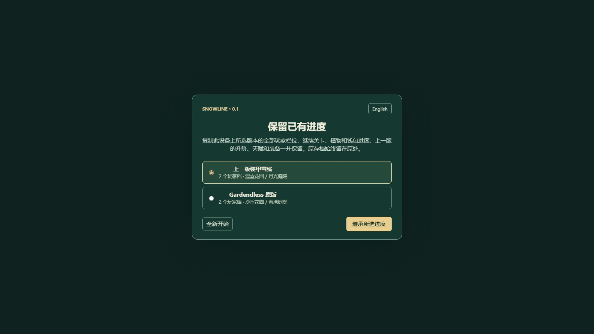
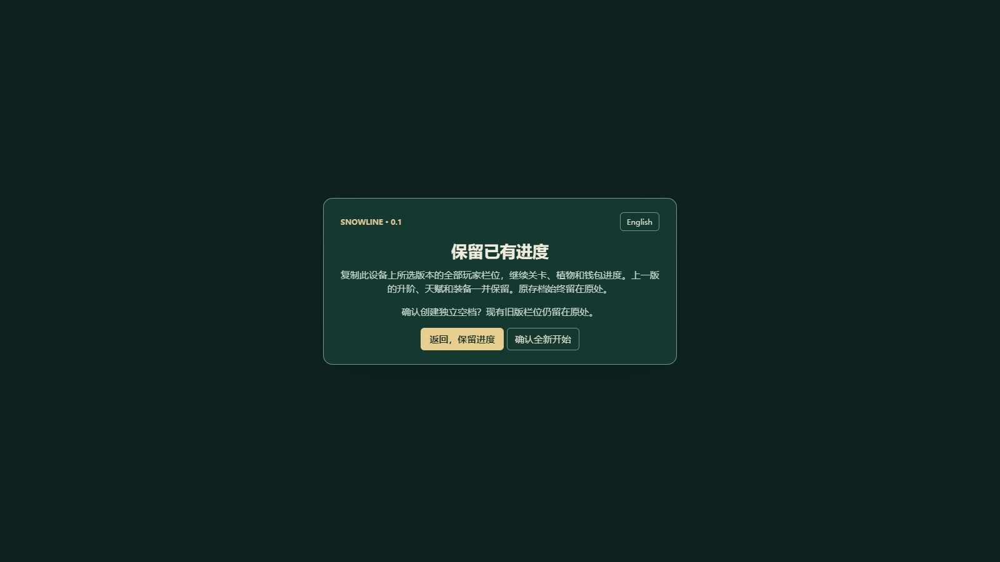

新档预置古埃及常规关卡和九株本世界植物。其余世界按游戏进度开放。完成引导后可领一把时空钥匙、1,000 钻石、100 进阶点、200,000 金币和一张植物自选卡。发行包内没有玩家个人存档。

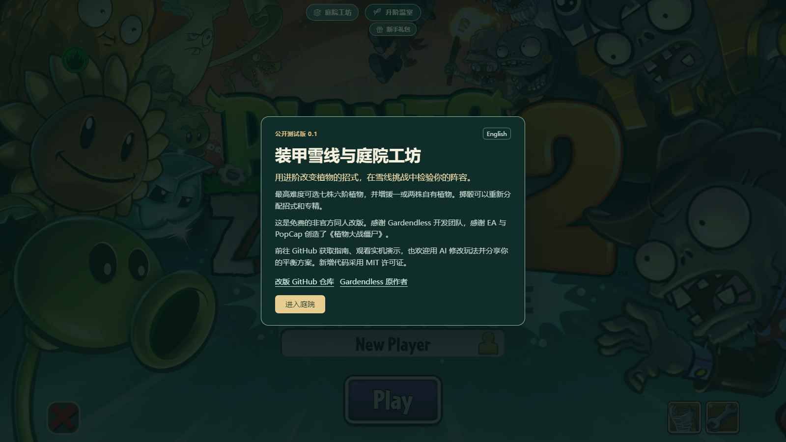

## 培养一株真正有分工的植物

普通关四档胜利分别给 3、5、8、12 进阶点。六次进阶每次为本株增加相当于基础值 5% 的伤害、5% 的攻速和 100% 的生命。土豆地雷把攻速换成更快就绪，向日葵把伤害换成更高的单颗阳光产量。每次永久培养给全园累加基础行动速度的 0.3%、基础生命的 10%，并使暴击伤害倍率增加 0.01。普通与挑战都计入历史培养层数，借来的临时阶数不增加永久层数。卡槽标出实际上阵的阶数，模仿者跟随复制对象。

**其他版本增加的可种植植物**会自动进入通用进阶。每升一阶增加基础伤害 10%、基础攻速 10%、基础生命 200%，按原始值逐阶相加。六阶本株因此达到 **1.60 倍伤害、1.60 倍攻速、13 倍生命**，全园培养另算。标准产阳光行为沿用产量和产速换算。这类植物保留原生行为，六阶采用纯数值强化。下文的三选招式与专精适用于本补丁单独设计的植物。

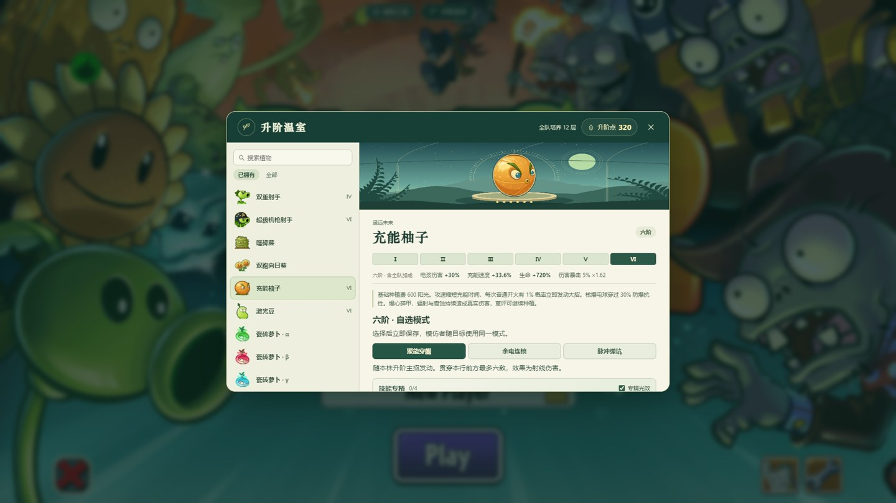

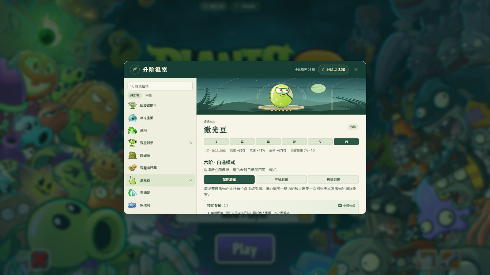

六阶植物有三个可切换的招式。每个招式有独立的四级专精，花进阶点、金币和钻石培养。激光豆可以打爆炸激光、分顾三行，或将射速提高 500%。战前可以查看各级的机制文字，再决定把最高专精留给谁。全园天赋还能改善种子冷却、植物生存、行动频率和暴击。

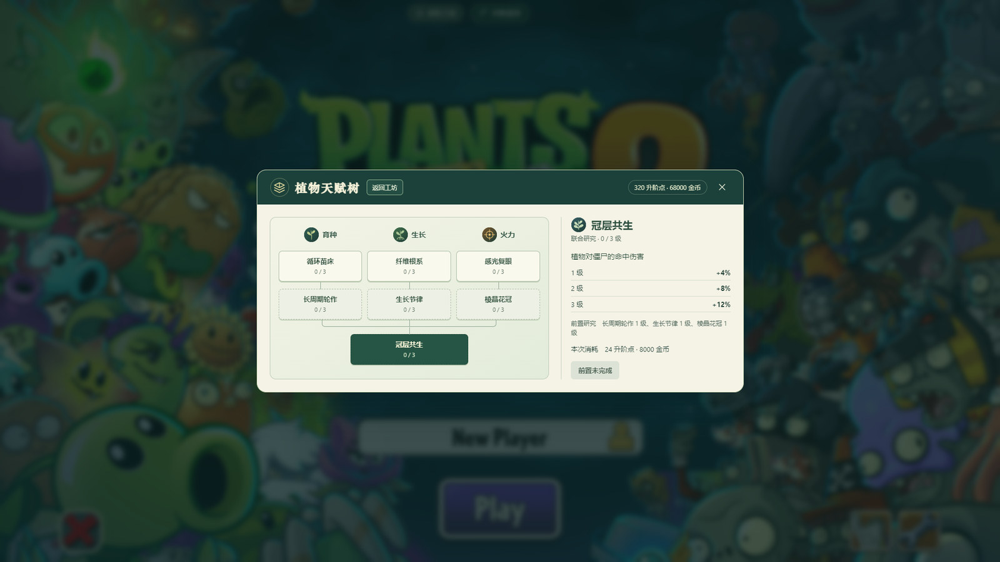

产阳植物到六阶专精四时，其自身产阳路线获得 3 倍产量乘区，另享原有本株加成。以无模拟、同一全园培养的向日葵为例，每颗阳光相对五阶约为 3.12 倍。六阶产阳路线也能用护盾和局部拦截保护附近的植物。

## 选哪一株会改变战场

在最高难度打开能自己选卡的关卡，选择雪线挑战。系统给七株六阶植物，另有两个增援席，可以带零株、一株或两株自己拥有的植物。超级机枪豌豆、瓷砖萝卜、充能柚子是三个超级植物家族。**只计算自选席**，同一家族只计一次。收藏常用植物能快速选卡，超级植物固定靠前。

| 实际阵容 | 准备时间 | 敌人移速 | 敌人伤害 | 敌人本体生命 | 正式入场 | 通关金币／钻石／进阶点 |
|---|---:|---:|---:|---:|---:|---|
| 七株远征 | 13 秒 | ×1.6 | ×3 | ×5 | 免费 | 10,000／20／60 |
| 普通增援一至两株 | 13 秒 | ×1.92 | ×6 | ×7.5 | 免费 | 10,000／20／60 |
| 一家超级植物 · 铁血枭雄 | 10 秒 | ×2.496 | ×12 | ×15 | 30 钻 | 15,000／30／90 |
| 两家超级植物 · 噩梦 | 7 秒 | ×3.2448 | ×24 | ×30 | 30 钻 | 20,000／40／120 |

敌人倍率相对于同关普通敌人，表中生命另加防具带来的生命。带增援后，波数约为七株远征的 1.5 倍。所有挑战开局增加 1,000 阳光，植物冷却减半。植物僵尸在第一面旗后加入，棱镜草从第二面旗开始抽走阳光，余额可以为负。

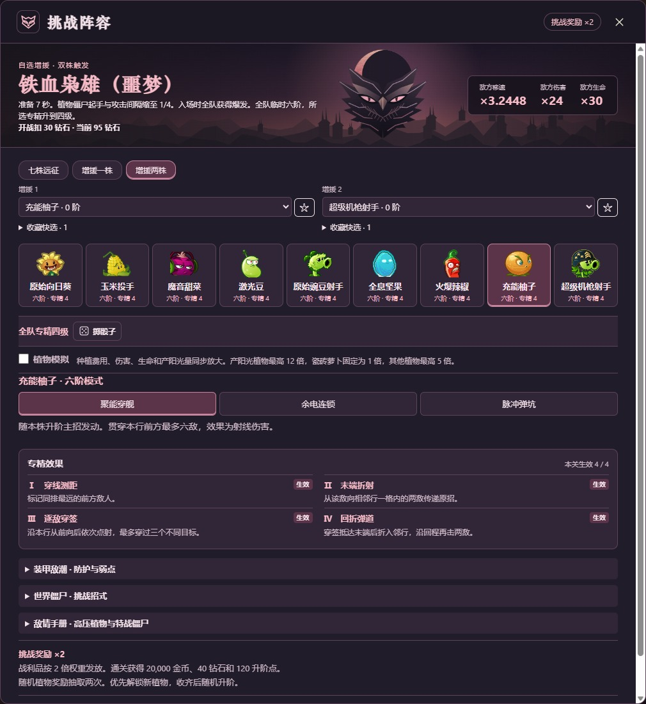

- **选卡和重试**。枭雄与噩梦均在正式按下原版开战键时扣一次费。可以免费更换阵容或退出选卡。正式重试是新的一场，需再次付费。两种模式的植物自带原版落地爆发，玩家已购买的爆发次数会保留。
- **技能和专精**。一般挑战和枭雄的七株给定植物分配四个专精Ⅰ、两个专精Ⅲ、一个专精Ⅳ，增援保留自有培养。噩梦所有设计植物临时六阶、所选技能专精Ⅳ。模仿者复制左边的植物。兼容植物仅有数值成长。普通传送带等固定卡关沿用五阶规则。
- **植物模拟**。一般植物可调到 5 倍，产阳植物到 12 倍，瓷砖萝卜固定 1 倍。模拟倍率同时作用于种植费用、伤害、最大生命和对应的产阳量。模仿者采用实际复制对象的设置。
- **战利品**。胜利正常推进原关首通。挑战内自动收集主要掉落，基础金币、钻石、进阶点权重为 10、20、5 倍。表中固定结算另含随机植物名额，枭雄有一份并有一半机会再得一份，噩梦两份。收齐后改为随机升阶，已全部满阶则累加全园培养。

## 看装备，也要看敌人站在哪里

普通关四档的成套头盔＋背心比例依次为 **6%、12%、20%、30%**。各档的特殊增援预算各含 1、2、3、4 名植物僵尸和同数迫击炮手，关卡提前结束时按其原目标结算。四难度包含少量高危植物僵尸。迫击炮优先瞄准主力输出，看到准星可以打断蓄力、移位或动用拦截工事。

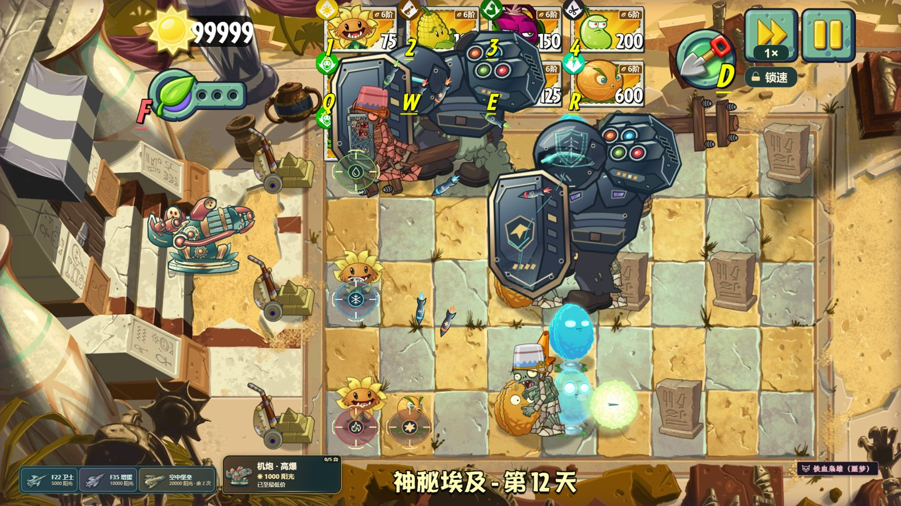

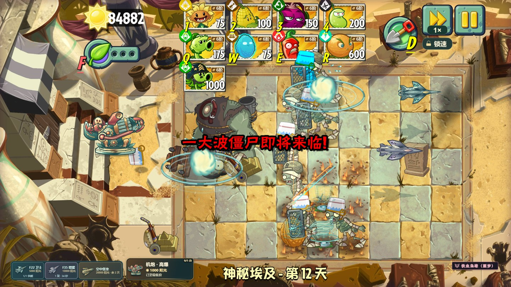

雪线挑战的盾卫能用正面重盾拦住激光，并替身后的队伍承受从正面来的爆炸。精英还能掩护邻行。重盾和曜纹精英的盾耐久分别为 24,000 和 48,000。穿甲机炮擅长磨盾，远程炮击可越盾打后排，敌人身上的头盔与背心仍会生效。

每十名实际生成的挑战敌人中随机挑一名获得迷彩，兵种不限。迷彩敌人的帽衣较弱，植物可正常瞄准。地面重装和航空无法直接锁定它，来自这些武器的爆炸旁伤也会先被削去 80%。把整排火力交给重装，就会给迷彩留下空隙。

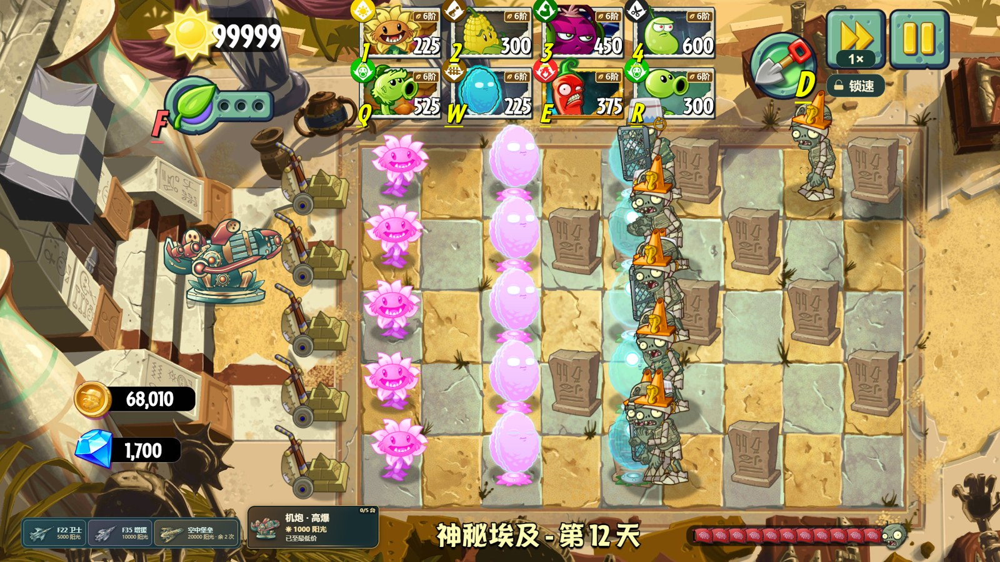

每场挑战至少有六名超级重装巨人。它们的背架会发射高爆、液氮、神经毒素和燃烧火箭，可以用拦截装备应对。护甲尚在时能吸收约 99% 的爆炸与穿透伤害，充能柚子无法直接秒杀它。噩梦头盔和背心分别获得 1.75 倍和 2 倍耐久，额外提高常规、防爆及抗碎甲能力。先确认是谁在替后排挡伤，再决定什么时候叫航空支援。

## 在选卡时换装

地面重装四选一，航空和拦截器有独立装备位。普通冒险的地面重装与航空最高按四级出战，只能派一架 F22。挑战使用已购等级，最高七级。传送带、坚不可摧和其他无法靠植物获取阳光的关卡默认使用免费常驻狙击塔，航空禁用。这一临时配置会随本关结束。

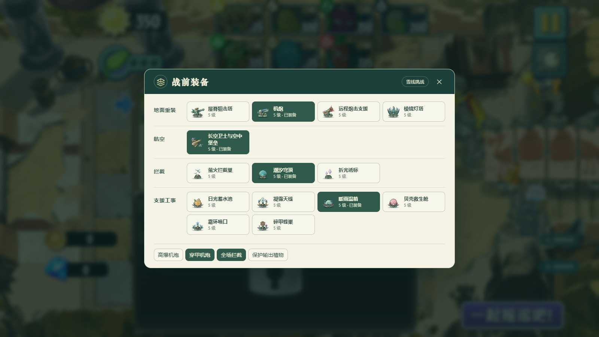
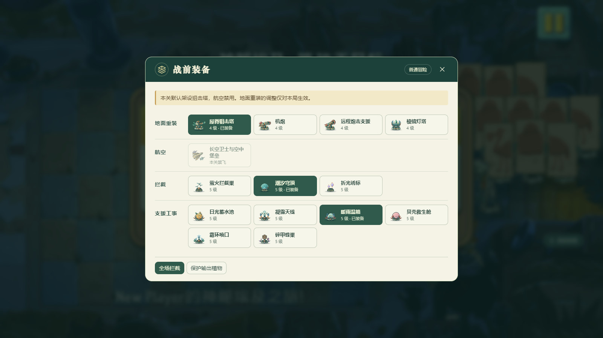

机炮首次 1,000 阳光，成功部署后涨 250，每 25 游戏秒回落 50，最低 1,000，最多五台。五级穿甲型专打同排装甲。远程炮击固定 3,000。F22 负责侦察与持续火力，F35 提供 40 秒增援和持续燃烧，空中堡垒每局最多两次，分别消耗 20,000 和 40,000 阳光。

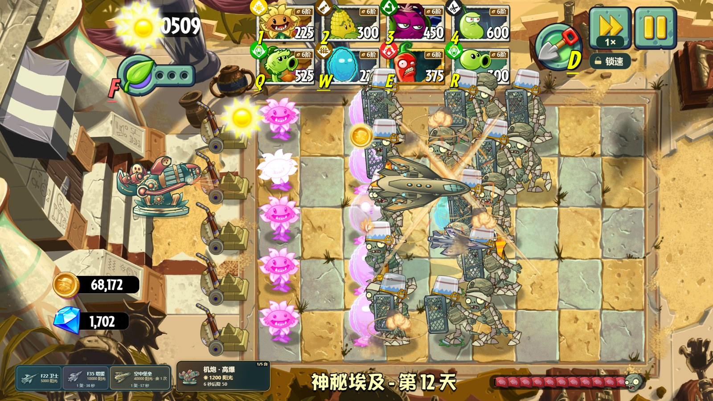

每架持续供能的 F22 给所有植物增加 2% 伤害、0.05 暴击倍率和 0.5 个百分点碎甲。碎甲通常最多 5%，噩梦最多 12%。F35 的制导副弹在噩梦里可以跨行分打。堡垒轮换制导、钻地和空爆，空爆能越过前排盾卫与巨人给后排的遮挡。

倍速可在 1、1.5、2、3、4、5 倍间切换，速度锁可阻止突破预警自动降速。设置内可随时关闭全息技能特效，战斗机制继续生效。

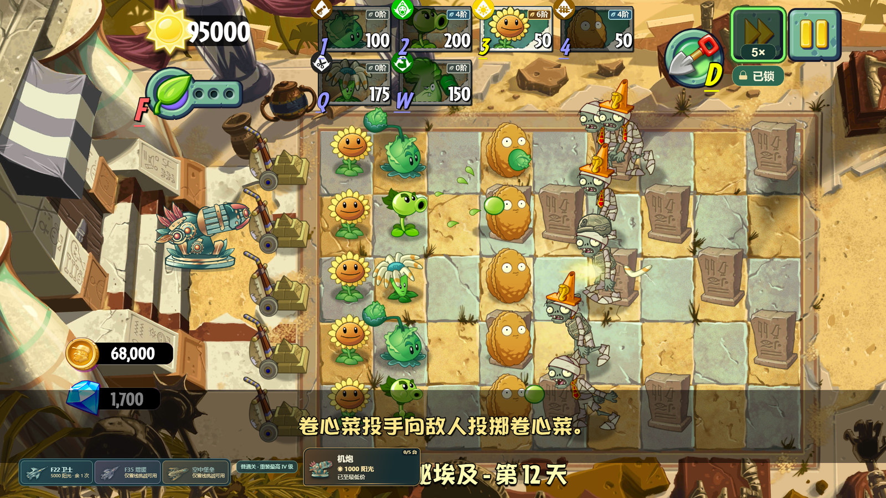

## 非盈利、鸣谢与继续创作

本版免费提供给玩家测试、学习与交流，不售卖下载、不植入广告，不接受付费解锁。感谢 **Gzh0821 和 Gardendless 团队**以及翻译和社区贡献者，让玩家能够在 PC 上继续种植和创作。感谢 **PopCap 与 Electronic Arts** 创造《植物大战僵尸》及其角色。本作由玩家独立制作。[Gardendless 原作者的 GitHub](https://github.com/Gzh0821/pvzg_site) · [权利与鸣谢](THIRD-PARTY.md)

欢迎用 AI 辅助定制本仓库的原创玩法代码。可以从一株植物或一件装备开始，用同一关、同一阵容比较两种设计，再把关卡、难度和实测结果附到 Issue 或 PR。新增代码采用 MIT 许可证。游戏本体和第三方素材遵循各自的授权。[定制入门 / Customization](CUSTOMIZING.md) · [MIT 许可证](LICENSE)
