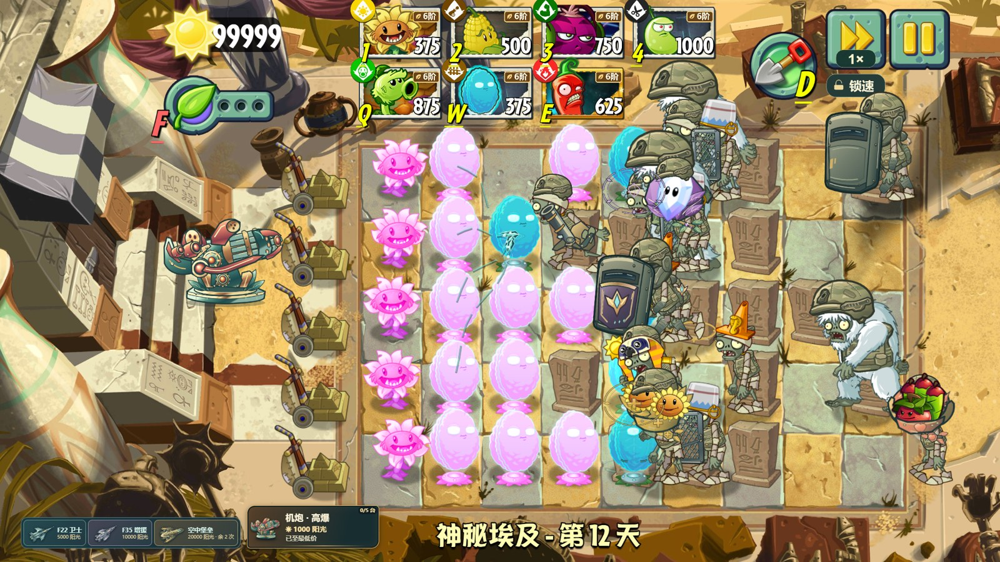
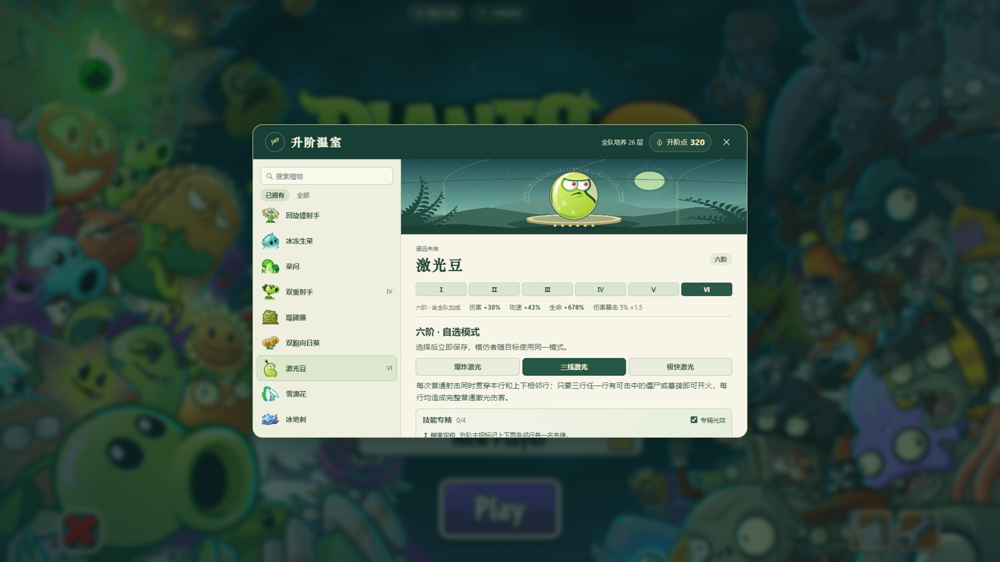
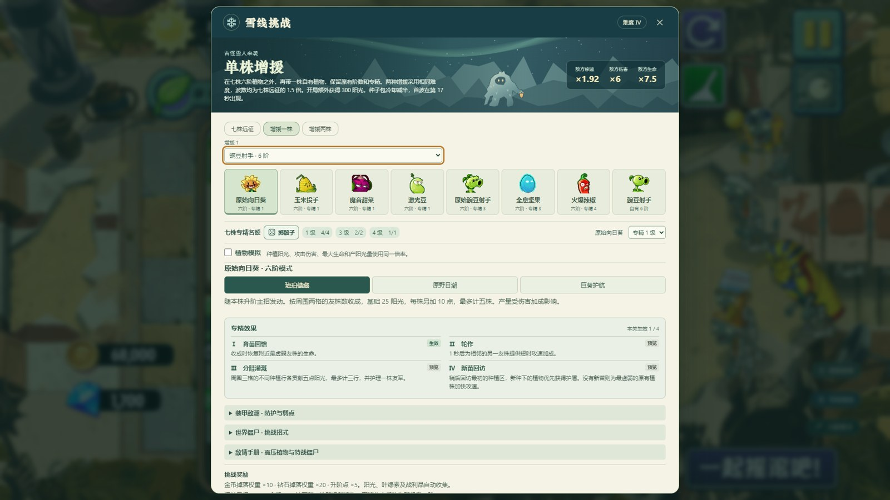
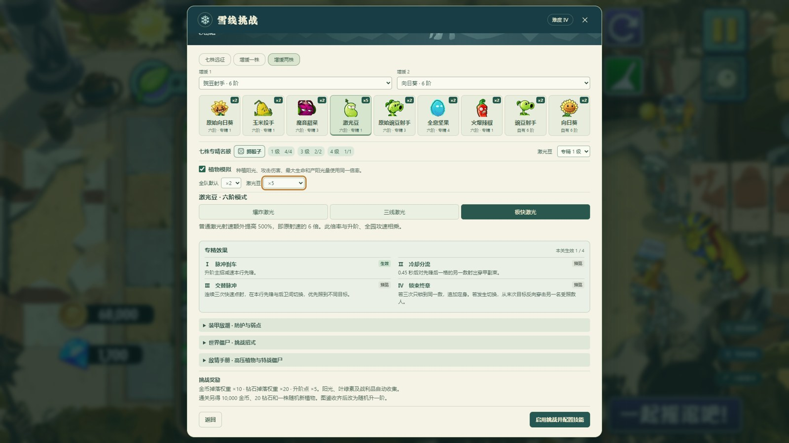
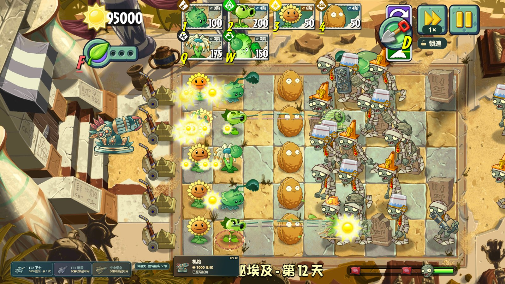

# 装甲雪线与庭院工坊 · 公开测试版 0.1

[English](README.en.md) · [下载 Windows 补丁](https://github.com/songsiyi2006-chem/pvz2-gardendless-snowline/releases/download/v0.1-r2/Snowline-Patch-v0.1-Windows.zip) · [中英图解指南](https://github.com/songsiyi2006-chem/pvz2-gardendless-snowline/releases/download/v0.1-r2/Snowline-Field-Guide-v0.1.pdf) · [两分钟实机宣传片 · 无音轨](https://github.com/songsiyi2006-chem/pvz2-gardendless-snowline/releases/download/v0.1-r2/Snowline-v0.1-Trailer.mp4)

这是一款基于 PVZ2 Gardendless 的免费非官方玩法改版。**进阶**决定一株植物在阵容里能做什么，**雪线挑战**检验这套阵容能否应对护甲、迷彩和迫击炮。可以先在普通冒险攒进阶点，再回到熟悉的地图，尝试完全不同的打法。

点击画面可下载两分钟实机短片。图片和视频均取自 0.1 发行文件。为展示高阶技能与装备，拍摄使用独立的演示阵容。

## 安装补丁，继续原来的花园

1. 准备自己下载的 Gardendless Windows 单文件游戏。目前已适配 **0.16.24 标准版、0.16.24 Lite、0.16.15 标准版、0.16.14 标准版**。Lite 使用 AVIF 贴图，需要能解码 AVIF 的 WebView2 运行时。[原项目历史版本](https://github.com/Gzh0821/pvzg_site/releases)
2. 完整解压补丁，双击 `Snowline-Patch.exe`，选择原版 EXE，再为生成的游戏选择新文件名。补丁会在本机检查游戏脚本和资源布局，原版可继续运行。对其他 Windows 构建，可运行 `.\Snowline-Patch.exe --check "D:\Games\pvzge.exe"` 先做兼容性预检。预检核对挂载点，实际游玩仍需该版本的实机验证。
3. **直接运行生成的游戏即可续玩。** 在同一个 Windows 用户、同一游戏数据目录内，已有 0.1 存档会直接打开。只有一个可识别旧档来源时，自动复制其中的全部玩家栏位。原版与上一版雪线都有存档时，默认选中上一版雪线，也可以主动选择原版。关卡、植物、钱包和当前玩家栏位随档继承，雪线档还保留升阶、天赋与装备。旧版存档保留在原处。
4. 双来源选择界面的 Enter 和 Esc 都会继续继承。手动点“全新开始”还需再次确认，返回按钮默认获得焦点。没有旧档的玩家会获得本版起始花园。跨电脑或不同游戏数据目录，可通过原游戏的玩家界面导出和导入存档。

以上四个版本都在 Windows 上实际启动过。标准版验证了从两个来源选择存档，Lite 另验证了在 WebView2 137 下加载贴图并进入主场景。本次测试使用独立玩家档。

新档预置古埃及常规关卡和九株本世界植物。其余世界按游戏进度开放。完成引导后可领一把时空钥匙、1,000 钻石、100 进阶点、200,000 金币和一张植物自选卡。发行包内没有玩家个人存档。

## 培养一株真正有分工的植物

普通关四档胜利分别给 3、5、8、12 进阶点。六次进阶每次为本株增加相当于基础值 5% 的伤害、5% 的攻速和 100% 的生命。土豆地雷把攻速换成更快就绪，向日葵把伤害换成更高的单颗阳光产量。每次永久培养还给全队累加 0.5% 攻速、3% 生命。卡槽标出实际上阵的阶数，模仿者跟随复制对象。

**其他版本增加的可种植植物**会自动进入通用进阶。每升一阶增加基础伤害 10%、基础攻速 10%、基础生命 200%，按原始值逐阶相加。六阶本株因此达到 **1.60 倍伤害、1.60 倍攻速、13 倍生命**，全园培养另算。标准产阳光行为沿用产量和产速换算。这类植物保留原生行为，六阶采用纯数值强化。下文的三选招式与专精适用于本补丁单独设计的植物。

六阶植物有三个可切换的招式。每个招式有独立的四级专精，花进阶点、金币和钻石培养。激光豆可以打爆炸激光、分顾三行，或将射速提高 500%。战前可以查看各级的机制文字，再决定把最高专精留给谁。全园天赋还能改善种子冷却、植物生存、行动频率和暴击。

## 雪线挑战有三种阵容

在能自由选卡的正式关卡选择最高难度，然后打开雪线挑战。给定七株均为六阶，战前把它们分配为四株专精Ⅰ、两株专精Ⅲ、一株专精Ⅳ。可以逐一挑选招式，也可以掷骰重排。固定卡、传送带等原生关卡沿用自己的五阶出战规则。

| 相对同关普通敌人 | 七株远征 | 七株＋自选一株或两株 |
|---|---:|---:|
| 移速 | 1.6 倍 | 1.92 倍 |
| 攻击伤害 | 3 倍 | 6 倍 |
| 本体生命倍率，再加护具体力 | 5 倍 | 7.5 倍 |
| 波数 | 由原关重新编排 | 七株远征约 1.5 倍 |

开战后有 **17 个游戏秒**发育，起始阳光增加 300，挑战种子冷却减半。旗帜更多、旗距更短，普通阴间植物僵尸从第一面旗加入，棱镜草守到第二面旗才进场。植物模拟可逐株选择 1–5 倍，种植费用、伤害、实际最大生命及产阳光值按所选倍率同步变化。选一株或两株增援使用同一套难度，额外植物保留自己的培养进度。

胜利会推进原关首通。金币、钻石、进阶点的挑战权重分别为 10、20、5 倍，挑战内自动收集阳光和主要掉落。结算另给 10,000 金币、20 钻石及一株随机未持有植物。集齐后改为随机升阶，全部满阶则增加全队培养。

## 看装备，也要看敌人站在哪里

普通关四档的成套头盔＋背心比例依次为 **6%、12%、20%、30%**。各档的特殊增援预算各含 1、2、3、4 名植物僵尸和同数迫击炮手，关卡提前结束时按其原目标结算。四难度包含少量高危植物僵尸。迫击炮优先瞄准主力输出，看到准星可以打断蓄力、移位或动用拦截工事。

雪线挑战的盾卫能用正面重盾拦住激光，并替身后的队伍承受从正面来的爆炸。精英还能掩护邻行。重盾和曜纹精英的盾耐久分别为 24,000 和 48,000。穿甲机炮擅长磨盾，远程炮击可越盾打后排，敌人身上的头盔与背心仍会生效。

每十名实际生成的挑战敌人中随机挑一名获得迷彩，兵种不限。迷彩敌人的帽衣较弱，植物可正常瞄准。地面重装和航空无法直接锁定它，来自这些武器的爆炸旁伤也会先被削去 80%。把整排火力交给重装，就会给迷彩留下空隙。

## 在选卡时换装

地面重装四选一，航空和拦截器有独立装备位。普通冒险的地面重装与航空最高按四级出战，只能派一架 F22。挑战使用已购等级，最高七级。传送带、坚不可摧和其他无法靠植物获取阳光的关卡默认使用免费常驻狙击塔，航空禁用。这一临时配置会随本关结束。

机炮首次 1,000 阳光，成功部署后涨 250，每 25 游戏秒回落 50，最低 1,000，最多五台。五级穿甲型专打同排装甲。远程炮击固定 3,000。F22 负责侦察与持续火力，F35 提供 40 秒增援和持续燃烧，空中堡垒每局最多两次，分别消耗 20,000 和 40,000 阳光。

倍速可在 1、1.5、2、3、4、5 倍间切换，速度锁可阻止突破预警自动降速。设置内可随时关闭全息技能特效，战斗机制继续生效。

## 非盈利、鸣谢与继续创作

本版免费提供给玩家测试、学习与交流，不售卖下载、不植入广告，不接受付费解锁。感谢 **Gzh0821 和 Gardendless 团队**以及翻译和社区贡献者，让玩家能够在 PC 上继续种植和创作。感谢 **PopCap 与 Electronic Arts** 创造《植物大战僵尸》及其角色。本作由玩家独立制作。[Gardendless 原作者的 GitHub](https://github.com/Gzh0821/pvzg_site) · [权利与鸣谢](THIRD-PARTY.md)

欢迎用 AI 辅助定制本仓库的原创玩法代码。可以从一株植物或一件装备开始，用同一关、同一阵容比较两种设计，再把关卡、难度和实测结果附到 Issue 或 PR。新增代码采用 MIT 许可证。游戏本体和第三方素材遵循各自的授权。[定制入门 / Customization](CUSTOMIZING.md) · [MIT 许可证](LICENSE)
